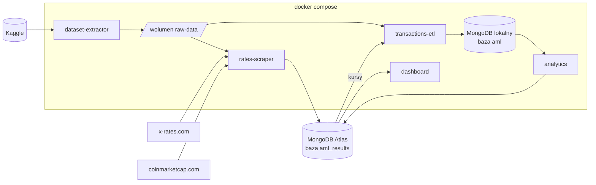
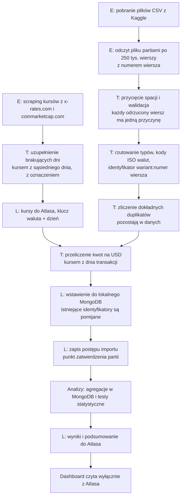
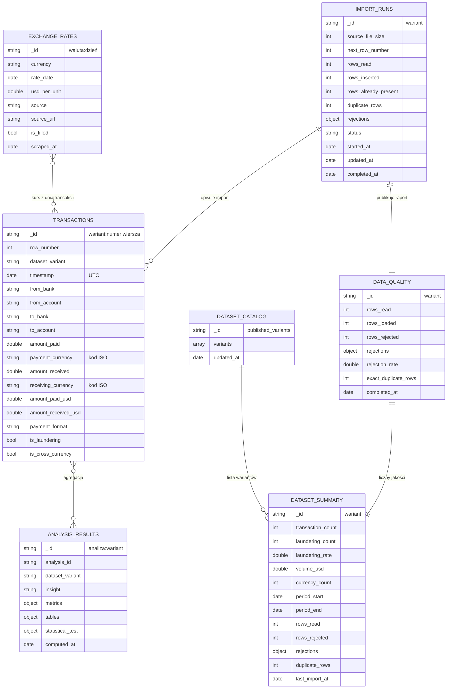
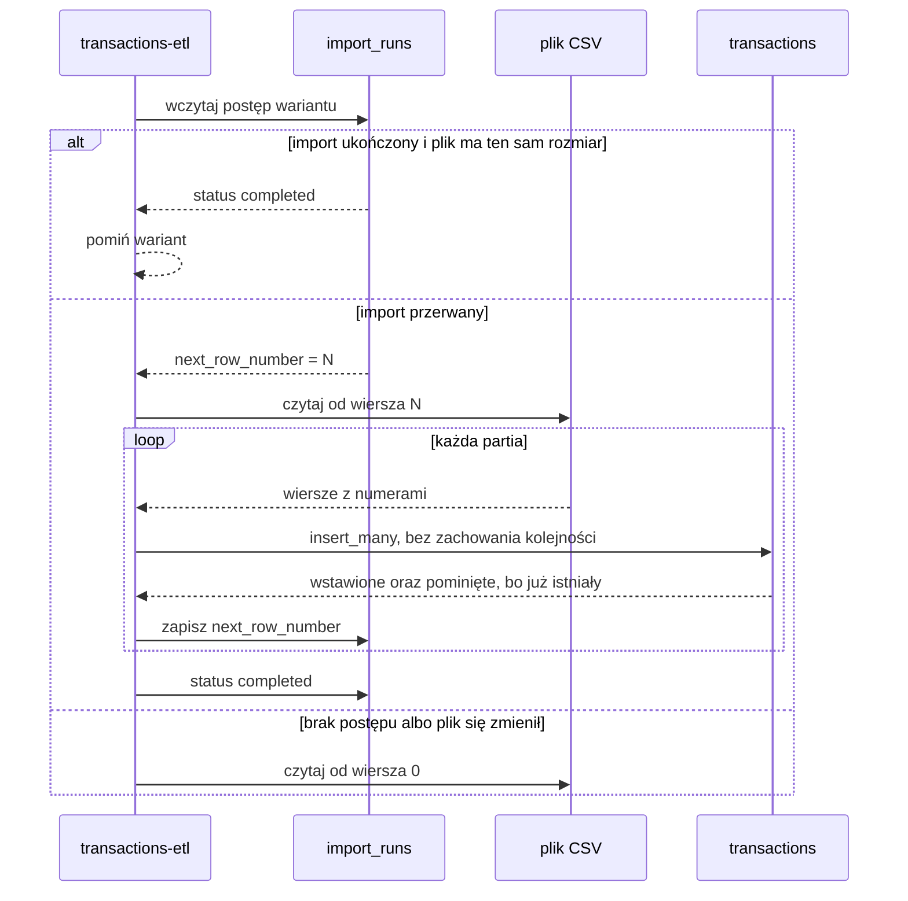

# AML Big Data ETL

Pipeline ETL w kontenerach, który pobiera transakcje bankowe ze zbioru IBM AML, przelicza je na dolary po kursach zczytanych z internetu, ładuje do MongoDB i pokazuje wyniki pięciu analiz statystycznych w dashboardzie.

Pytanie, na które odpowiada projekt: **czym transakcje oznaczone jako pranie pieniędzy różnią się od zwykłych?**

## Źródła danych

| Źródło | Co z niego bierzemy | Jak |
|---|---|---|
| [Kaggle: IBM Transactions for Anti Money Laundering](https://www.kaggle.com/datasets/ealtman2019/ibm-transactions-for-anti-money-laundering-aml) | Syntetyczne transakcje bankowe (pliki `*_Trans.csv`, warianty Medium mają razem ok. 6 GB) | Pobranie pojedynczych plików przez `kagglehub` |
| [x-rates.com](https://www.x-rates.com/historical/?from=USD&amount=1&date=2022-09-01) | Dzienne kursy 13 walut tradycyjnych wobec USD | Web scraping tabeli HTML, jedna strona na dzień |
| [coinmarketcap.com](https://coinmarketcap.com/historical/20220901/) | Dzienna cena Bitcoina w USD | Web scraping tabeli HTML, jedna strona na dzień |

Scraper przedstawia się nagłówkiem `User-Agent: aml-etl-course-project/1.0`, czeka sekundę między zapytaniami i pobiera każdą stronę tylko raz. Plik `robots.txt` obu serwisów nie zabrania pobieranych adresów.

## Szybki start dla prowadzącego

Potrzebny jest tylko Docker. Dane nie są pobierane, a dashboard czyta gotowe wyniki z MongoDB Atlas.

```bash
git clone <adres repozytorium>
cd big-data-etl
cp .env.example .env
```

W pliku `.env` ustaw `ATLAS_URI` na adres tylko do odczytu podany w sprawozdaniu, a potem uruchom sam dashboard:

```bash
docker compose up --no-deps dashboard
```

Dashboard jest pod adresem <http://localhost:8050>.

## Pełny pipeline

### Wymagania

- Docker z Docker Compose (Docker Desktop na Windows i macOS).
- Co najmniej 8 GB pamięci przydzielonej Dockerowi; zalecane 16 GB RAM w komputerze.
- Wolne miejsce na dysku: ok. 20 GB dla wariantów Medium (6 GB plików i ok. 10 GB bazy, plus zapas), ok. 2 GB dla trybu próbnego.
- Konto Kaggle nie jest potrzebne, bo zbiór jest publiczny. Jeśli Kaggle zacznie wymagać logowania, wpisz `KAGGLE_USERNAME` i `KAGGLE_KEY` do `.env`.

### Uruchomienie

```bash
cp .env.example .env
docker compose up --build
```

Serwisy uruchamiają się po kolei i każdy czeka na poprawne zakończenie poprzedniego:

1. `dataset-extractor` pobiera pliki z Kaggle na wolumen `raw-data`.
2. `rates-scraper` zczytuje kursy walut dla zakresu dat transakcji i zapisuje je w Atlasie.
3. `transactions-etl` czyści transakcje, przelicza kwoty na USD i ładuje je do lokalnego MongoDB.
4. `analytics` liczy pięć analiz i publikuje wyniki w Atlasie.
5. `dashboard` pokazuje wyniki pod adresem <http://localhost:8050>.

Pełny przebieg na wariantach Medium trwa ok. 2,5 godziny na laptopie z 8 GB pamięci dla Dockera: pobranie plików 5 min, scraping 1–2 min, import 50 min, analizy 90 min. Dokładne liczby są w `docs/report/evidence/counts.md`.

Ponowne `docker compose up` niczego nie duplikuje: pliki nie są pobierane drugi raz, scraper nie pobiera żadnej strony, a import jest pomijany. Import przerwany w połowie wznawia się od zapamiętanego numeru wiersza.

### Tryb próbny

Ustaw w `.env` wartość `DATASET_VARIANTS=HI-Small`. Cały łańcuch przechodzi wtedy w ok. 5–6 minut (5 mln transakcji).

### Pojedyncze kroki

```bash
docker compose run --rm dataset-extractor
docker compose run --rm rates-scraper
docker compose run --rm transactions-etl
docker compose run --rm analytics
docker compose up --no-deps dashboard
```

`docker compose run` uruchamia też serwisy, od których dany krok zależy. Dodaj `--no-deps`, żeby uruchomić tylko jeden.

### Konfiguracja (`.env`)

| Zmienna | Domyślnie | Znaczenie |
|---|---|---|
| `DATASET_VARIANTS` | `HI-Medium,LI-Medium` | Warianty zbioru do przetworzenia, po przecinku. Dozwolone: `HI-` lub `LI-` z `Small`, `Medium`, `Large`. |
| `ATLAS_URI` | `mongodb://mongo-local:27017` | Adres bazy z kursami i wynikami. Bez Atlasa wskazuje lokalny kontener. |
| `ATLAS_DATABASE` | `aml_results` | Nazwa bazy z kursami i wynikami. |
| `LOCAL_MONGO_HOST_PORT` | `27018` | Port lokalnego MongoDB widoczny na komputerze. |
| `DASHBOARD_HOST_PORT` | `8050` | Port dashboardu widoczny na komputerze. |
| `LOG_LEVEL` | `INFO` | Poziom logów: `DEBUG`, `INFO`, `WARNING`, `ERROR`, `CRITICAL`. |
| `CSV_BATCH_ROWS` | `250000` | Liczba wierszy w jednej partii importu. |
| `MONGO_TIMEOUT_MS` | `10000` | Czas oczekiwania na połączenie z bazą. |
| `LOCAL_DATABASE` | `aml` | Nazwa lokalnej bazy z transakcjami. |
| `KAGGLE_DATASET` | `ealtman2019/ibm-transactions-for-anti-money-laundering-aml` | Identyfikator zbioru na Kaggle. |
| `KAGGLE_USERNAME`, `KAGGLE_KEY` | puste | Dane konta Kaggle, potrzebne tylko gdyby pobieranie wymagało logowania. |

W kontenerach `LOCAL_MONGO_URI` i `DATA_DIR` ustawia `docker-compose.yml`. Plik `.env` nie trafia do repozytorium.

## Samouczek: MongoDB Atlas

Surowe transakcje zostają w lokalnym MongoDB. W Atlasie są tylko kursy walut i wyniki analiz (kilkaset kilobajtów), więc wystarcza darmowy klaster M0.

1. Załóż konto na <https://www.mongodb.com/cloud/atlas> i utwórz projekt.
2. Utwórz klaster **M0** (darmowy), najlepiej w regionie Frankfurt.
3. W **Database Access** dodaj trzech użytkowników:
   - autor: rola `readWrite` na bazie `aml_results`,
   - druga osoba z zespołu: rola `readWrite` na bazie `aml_results`,
   - prowadzący: rola `read` wyłącznie na bazie `aml_results`.
4. W **Network Access** dodaj adres `0.0.0.0/0`, żeby baza była dostępna z dowolnego komputera.
5. Kliknij **Connect → Drivers**, skopiuj adres `mongodb+srv://...` i wpisz go do `.env` jako `ATLAS_URI` razem z nazwą użytkownika i hasłem.
6. Zostaw `ATLAS_DATABASE=aml_results`.

Uwagi:

- Każdy przebieg z tym samym `ATLAS_URI` nadpisuje wyniki, które widzi prowadzący. Ostatnim przebiegiem przed oddaniem musi być pełny przebieg `HI-Medium,LI-Medium`.
- Do pracy bez Atlasa wystarczy `ATLAS_URI=mongodb://mongo-local:27017`. Kursy i wyniki trafiają wtedy do osobnej bazy w lokalnym kontenerze.
- Hasła i adresy z danymi logowania nie pojawiają się w logach.

## Architektura

Jeden pakiet Pythona `aml_etl` i jeden obraz Dockera. Serwisy różnią się komendą startową i komunikują się wyłącznie przez bazy oraz wolumen z plikami.



### Przepływ ETL



### Kolekcje



Lokalna baza `aml` trzyma `transactions`, `import_runs` i `data_quality`. Baza `aml_results` w Atlasie trzyma `exchange_rates`, `analysis_results`, `dataset_summary` i `dataset_catalog`.

### Ponowne uruchomienie importu



Identyfikator transakcji to `wariant:numer wiersza w pliku`, więc ten sam wiersz zawsze dostaje ten sam identyfikator. Partia zapisana do bazy tuż przed awarią, której postęp nie zdążył się zapisać, jest przy wznowieniu wstawiana ponownie i w całości pomijana jako już istniejąca.

## Analizy

| Strona dashboardu | Pytanie | Metoda |
|---|---|---|
| Kwoty transakcji | Czy pranie różni się kwotą od zwykłych transakcji? | Percentyle, histogram w skali logarytmicznej, test Manna-Whitneya U |
| Formy płatności | Czy któraś forma płatności jest używana do prania częściej? | Odsetek prania per forma, test chi-kwadrat |
| Rozkład w czasie | Czy pranie skupia się w określonych godzinach lub dniach? | Odsetek prania per godzina i dzień tygodnia, test chi-kwadrat |
| Przewalutowania | Czy transakcje z wymianą waluty częściej są praniem? | Tabela 2×2, iloraz szans, test chi-kwadrat |
| Banki i konta | Czy pranie skupia się w małej grupie kont i banków? | Koncentracja na kontach nadawców, ranking banków |

Strony „Źródła i jakość” oraz „Kursy walut” pokazują raport odrzuconych wierszy, przepływ danych i zczytane kursy.

## Dla deweloperów

Potrzebny jest [uv](https://docs.astral.sh/uv/) i Docker (testy integracyjne uruchamiają MongoDB w kontenerze).

```bash
uv sync
uv run pre-commit install
uv run pytest
uv run pytest -m "not integration"
uv run mypy src scripts
uv run ruff check .
```

Zasady pilnowane automatycznie:

- **Bez komentarzy i docstringów** w plikach `.py`. Sprawdza to `scripts/check_no_comments.py` w pre-commit i w testach.
- **Granice importów:** podpakiety serwisów (`dataset_extractor`, `rates_scraper`, `transactions_etl`, `analytics`, `dashboard`) importują tylko `aml_etl.common`, nigdy siebie nawzajem. Sprawdza to `tests/test_import_boundaries.py`.
- Logowanie tylko przez `aml_etl.common.logging`, bez `print`.
- mypy w trybie `strict`, ruff jako linter i formater.

Struktura:

```
src/aml_etl/common/             konfiguracja, logger, połączenia z MongoDB, modele wyników
src/aml_etl/dataset_extractor/  pobieranie plików z Kaggle
src/aml_etl/rates_scraper/      scraping kursów walut
src/aml_etl/transactions_etl/   czytanie CSV, czyszczenie, przeliczenie na USD, ładowanie
src/aml_etl/analytics/          pięć analiz i publikacja wyników
src/aml_etl/dashboard/          aplikacja Dash
tests/                          testy, pomocniki w tests/support
docker/Dockerfile               jeden obraz dla wszystkich serwisów
```

## Najczęstsze problemy

| Objaw | Przyczyna i rozwiązanie |
|---|---|
| `port is already allocated` przy starcie `mongo-local` | Port 27018 jest zajęty. Ustaw w `.env` inny `LOCAL_MONGO_HOST_PORT`. To samo dla dashboardu i `DASHBOARD_HOST_PORT`. |
| `Cannot reach Atlas MongoDB at ...` | Adres IP nie jest na liście w **Network Access** albo hasło w `ATLAS_URI` jest błędne. Znaki specjalne w haśle trzeba zakodować (np. `@` jako `%40`). |
| Dashboard pokazuje „Brak połączenia z MongoDB Atlas” | Jak wyżej. Dashboard startuje także bez bazy i sprawdza połączenie przy każdym odświeżeniu. |
| Dashboard pokazuje „Brak wyników” | Pipeline jeszcze się nie zakończył albo `ATLAS_URI` wskazuje pustą bazę. Uruchom `docker compose up`. |
| `No exchange rates found in Atlas; run rates-scraper first` | Import uruchomiono przed scraperem. Uruchom `docker compose run --rm rates-scraper`. |
| Błąd `PageLayoutError` albo `PageFetchError` w `rates-scraper` | Strona z kursami zmieniła układ albo chwilowo blokuje zapytania. Komunikat zawiera adres strony. Pobrane już kursy są zapisane, więc ponowne uruchomienie pobiera tylko brakujące dni. |
| Pobieranie z Kaggle kończy się błędem 401 lub 403 | Wpisz `KAGGLE_USERNAME` i `KAGGLE_KEY` do `.env` (token z ustawień konta Kaggle). |
| Import zatrzymał się albo komputer się wyłączył | Uruchom ponownie `docker compose up`. Import wznowi się od zapamiętanego wiersza. |
| Brak miejsca na dysku albo powolne działanie | W Docker Desktop zwiększ limit dysku i pamięci (Settings → Resources). Nieużywane obrazy usuwa `docker image prune`. |
| Serwis kończy się jedną linią `... failed: ...` bez szczegółów | Ustaw `LOG_LEVEL=DEBUG` w `.env` i uruchom serwis ponownie, żeby zobaczyć pełny ślad błędu. |
| Chcę zacząć od zera | `docker compose down -v` usuwa lokalną bazę i pobrane pliki. Dane w Atlasie zostają. |
