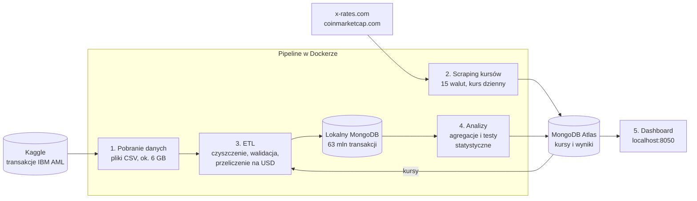

# AML Insight

**Czym transakcje prania pieniędzy różnią się od zwykłych przelewów?**

AML Insight odpowiada na to pytanie na podstawie ponad 63 milionów transakcji bankowych. Pobiera dane, ujednolica je do jednej waluty, wykonuje pięć analiz statystycznych i pokazuje wyniki w przejrzystym dashboardzie. Całość uruchamia się jedną komendą.

## Co pokazuje

Dashboard zestawia transakcje oznaczone jako pranie pieniędzy z pozostałymi w pięciu wymiarach:

| Obszar | Pytanie | Przykładowy wniosek (HI-Medium) |
|---|---|---|
| **Kwoty transakcji** | Czy pranie różni się kwotą? | Mediana prania jest 7,2 raza wyższa (6 068 USD wobec 845 USD), ale pranie unika bardzo dużych kwot. |
| **Formy płatności** | Którą drogą płyną pieniądze? | 87% prania idzie przelewami ACH. |
| **Rozkład w czasie** | Kiedy dochodzi do prania? | Odsetek prania w weekendy jest ponad dwa razy wyższy niż w dni robocze. |
| **Przewalutowania** | Czy pranie korzysta z wymiany walut? | Wśród 485 tys. transakcji z przewalutowaniem nie ma ani jednej oznaczonej jako pranie. |
| **Banki i konta** | Czy pranie skupia się w małej grupie kont? | 1% kont nadawców odpowiada za 92,5% transakcji prania. |

Każdy wniosek jest poparty testem statystycznym (Mann-Whitney U, chi-kwadrat) albo miarą koncentracji. Dodatkowe strony pokazują jakość danych (ile wierszy odrzucono i dlaczego) oraz dzienne kursy walut użyte do przeliczeń.

## Jak to działa



1. **Pobranie danych.** Z Kaggle pobierane są pliki z syntetycznymi transakcjami bankowymi IBM, w których każda transakcja ma oznaczenie, czy jest praniem pieniędzy.
2. **Scraping kursów.** Transakcje są w 15 walutach, w tym w Bitcoinie. Dla każdego dnia z zakresu danych pobierane są kursy wobec dolara: waluty tradycyjne z x-rates.com, Bitcoin z coinmarketcap.com.
3. **ETL.** Transakcje są wczytywane partiami, czyszczone i walidowane, a kwoty przeliczane na USD po kursie z dnia transakcji. Wynik trafia do lokalnego MongoDB. Import przerwany w połowie wznawia się od miejsca przerwania, a ponowne uruchomienie niczego nie duplikuje.
4. **Analizy.** Agregacje liczone bezpośrednio w MongoDB i testy statystyczne w SciPy. Gotowe wyniki, kilkaset kilobajtów, są publikowane w chmurze MongoDB Atlas.
5. **Dashboard.** Aplikacja Dash czyta wyłącznie z Atlasa, więc do przeglądania wyników nie są potrzebne surowe dane ani lokalna baza.

Surowe transakcje (ok. 10 GB w bazie) zostają lokalnie, a do chmury trafiają tylko kursy i wyniki. Dzięki temu wystarcza darmowy klaster Atlas.

## Dane

| Źródło | Zawartość |
|---|---|
| [IBM Transactions for Anti Money Laundering](https://www.kaggle.com/datasets/ealtman2019/ibm-transactions-for-anti-money-laundering-aml) | Syntetyczne transakcje bankowe z oznaczeniem prania. Warianty HI (wyższy odsetek prania) i LI (niższy), każdy w rozmiarach Small, Medium i Large. |
| [x-rates.com](https://www.x-rates.com/historical/?from=USD&amount=1&date=2022-09-01) | Historyczne dzienne kursy walut tradycyjnych wobec USD. |
| [coinmarketcap.com](https://coinmarketcap.com/historical/20220901/) | Historyczna dzienna cena Bitcoina w USD. |

## Uruchomienie

Potrzebny jest tylko Docker.

```bash
cp .env.example .env
docker compose up --build
```

Dashboard otwiera się pod adresem <http://localhost:8050>. Pełny przebieg na wariantach Medium trwa ok. 2,5 godziny. Szybki podgląd na 5 mln transakcji (ok. 5 minut): ustaw `DATASET_VARIANTS=HI-Small` w pliku `.env`.

Aby tylko przeglądać opublikowane wyniki, wpisz w `.env` adres Atlasa (`ATLAS_URI`) i uruchom sam dashboard: `docker compose up --no-deps dashboard`.

## Technologie

Python 3.12 · Polars · MongoDB (lokalnie i Atlas) · SciPy · Dash i Plotly · httpx i selectolax · Docker Compose
