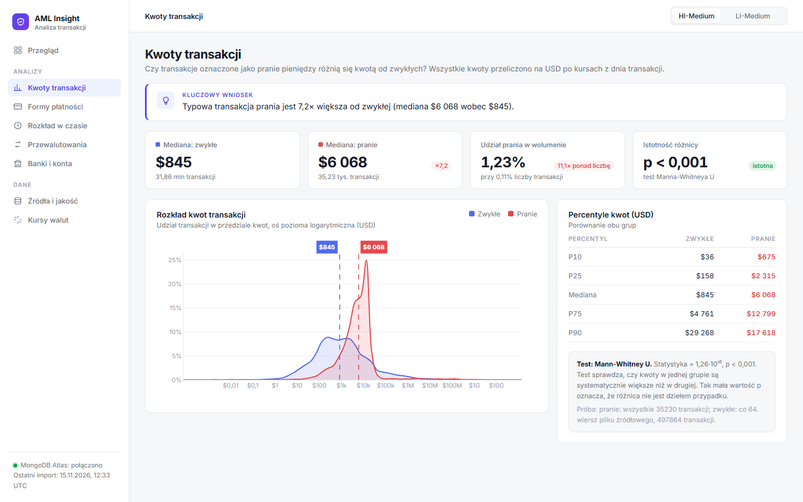
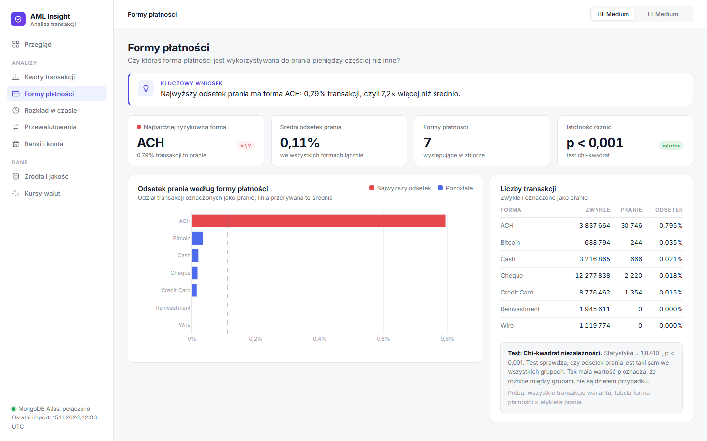
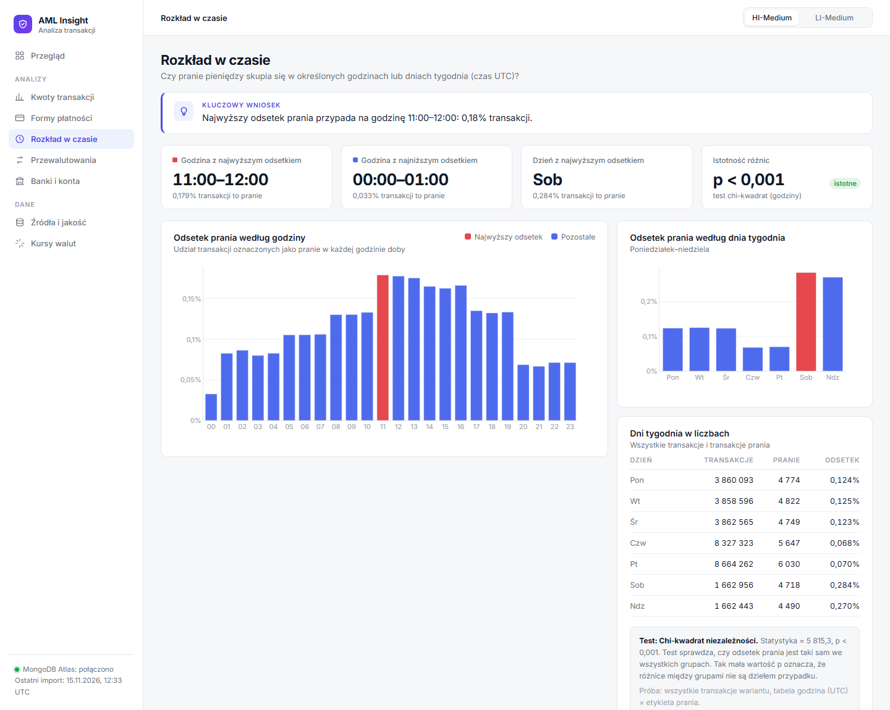
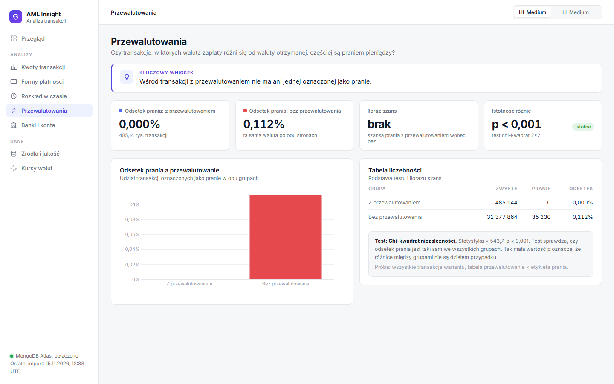
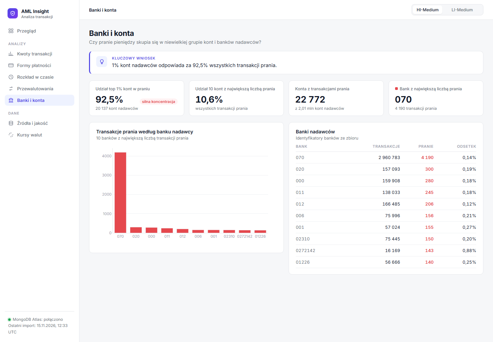
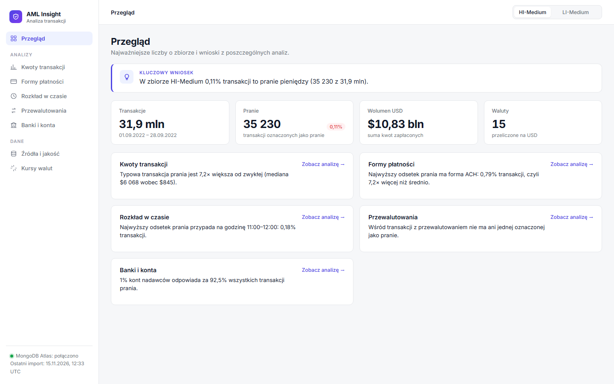
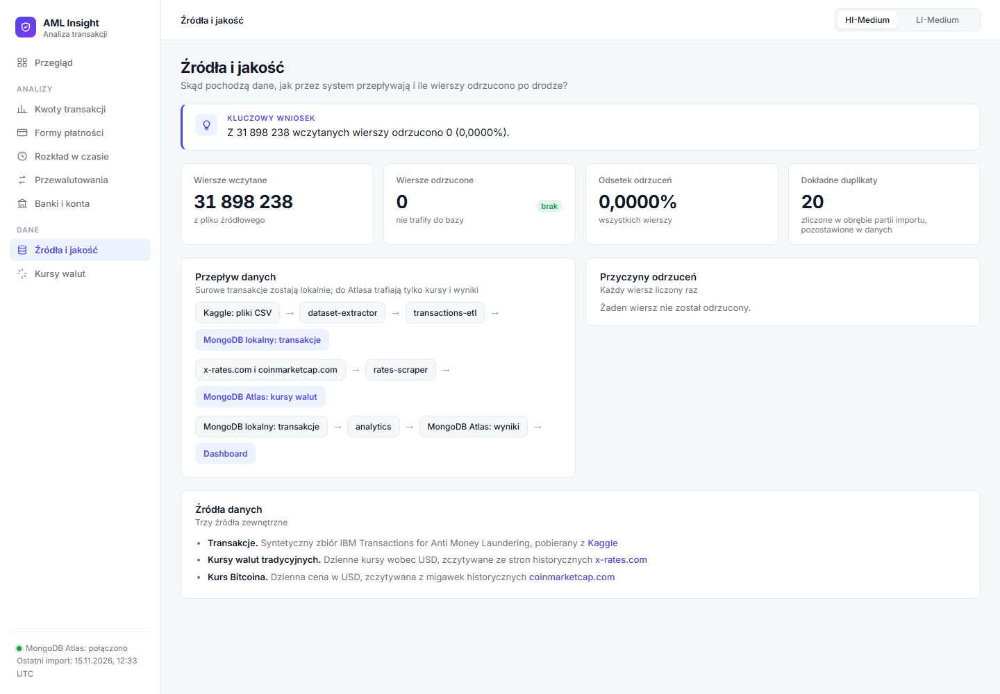
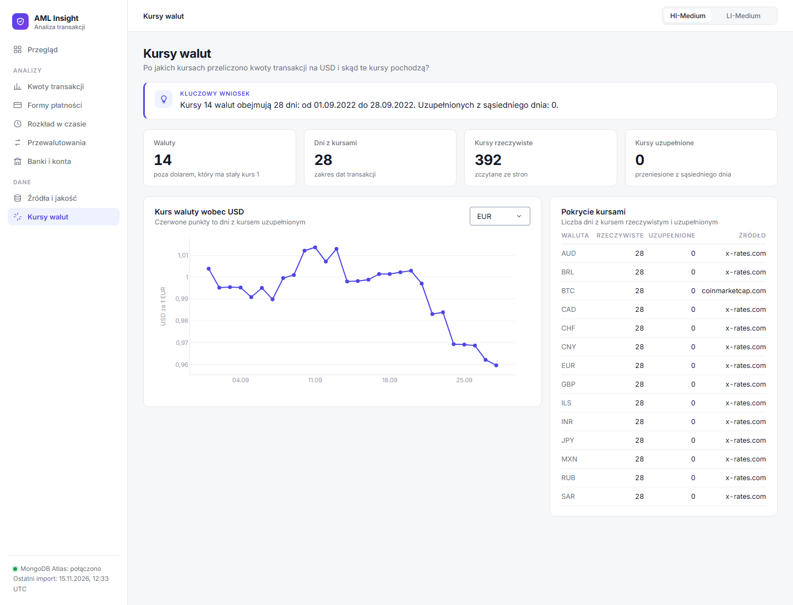

# AML Big Data ETL – sprawozdanie

Szkic do uzupełnienia przez autora. Miejsca wymagające uzupełnienia są oznaczone `<<DO UZUPEŁNIENIA ...>>`.

## 1. Problem i źródła danych

Projekt odpowiada na pytanie: **czym transakcje oznaczone jako pranie pieniędzy różnią się od zwykłych?** Porównujemy kwoty, formy płatności, pory dnia, przewalutowania oraz koncentrację na kontach i bankach.

| Źródło | Zawartość | Sposób pozyskania |
|---|---|---|
| Kaggle, zbiór [IBM Transactions for Anti Money Laundering](https://www.kaggle.com/datasets/ealtman2019/ibm-transactions-for-anti-money-laundering-aml) | Syntetyczne transakcje bankowe z symulatora IBM, z etykietą „pranie / nie pranie” | Pobranie plików `HI-Medium_Trans.csv` i `LI-Medium_Trans.csv` |
| [x-rates.com](https://www.x-rates.com/historical/?from=USD&amount=1&date=2022-09-01) | Dzienne kursy 13 walut tradycyjnych wobec dolara | Web scraping |
| [coinmarketcap.com](https://coinmarketcap.com/historical/20220901/) | Dzienna cena Bitcoina w dolarach | Web scraping |

Rozmiar danych po pobraniu:

| Plik | Rozmiar | Wiersze | Zakres dat |
|---|---|---|---|
| `HI-Medium_Trans.csv` | 3 031 783 420 B (2,82 GiB) | 31 898 238 | 01.09.2022 – 28.09.2022 |
| `LI-Medium_Trans.csv` | 2 976 436 978 B (2,77 GiB) | 31 251 483 | 01.09.2022 – 28.09.2022 |
| **Razem** | **6,01 GB (5,59 GiB)** | **63 149 721** | |

Wymóg co najmniej 5 GB danych jest spełniony. Kursy walut są potrzebne, bo transakcje są w 15 walutach i bez przeliczenia na jedną walutę nie da się porównywać kwot.

## 2. Architektura i przepływ danych

Pipeline to pięć serwisów uruchamianych przez `docker compose up`. Wszystkie korzystają z jednego obrazu Dockera i jednego pakietu Pythona, a różnią się komendą startową. Każdy serwis czeka na poprawne zakończenie poprzedniego.

| Serwis | Zadanie | Skąd czyta | Dokąd zapisuje |
|---|---|---|---|
| `dataset-extractor` | Pobiera pliki z Kaggle | Kaggle | wolumen z plikami |
| `rates-scraper` | Zczytuje kursy walut | x-rates.com, coinmarketcap.com | Atlas: `exchange_rates` |
| `transactions-etl` | Czyści, przelicza na USD i ładuje transakcje | pliki CSV, kursy z Atlasa | lokalny MongoDB: `transactions` |
| `analytics` | Liczy pięć analiz | lokalny MongoDB | Atlas: `analysis_results`, `dataset_summary` |
| `dashboard` | Pokazuje wyniki | wyłącznie Atlas | – |

Dwie bazy mają różne role:

- **Lokalny MongoDB** (kontener) trzyma surowe transakcje: 63 mln dokumentów, ok. 9,9 GB razem z indeksami. To za dużo na darmowy klaster w chmurze.
- **MongoDB Atlas** (darmowy klaster M0, limit 512 MB) trzyma tylko kursy walut i wyniki analiz. Dzięki temu dashboard można uruchomić na dowolnym komputerze bez pobierania danych.

Diagramy architektury, przepływu ETL, schematu kolekcji i ponownego uruchomienia importu są w pliku `README.md` (sekcja „Architektura”). <<DO UZUPEŁNIENIA: wklej obrazy czterech diagramów z README, np. zrzuty z podglądu na GitHubie>>

## 3. Pobieranie danych i web scraping

**Pliki z Kaggle.** Serwis pobiera tylko dwa potrzebne pliki, a nie całe archiwum zbioru (ponad 40 GB). Plik trafia najpierw do katalogu tymczasowego, a po pobraniu jest przenoszony na miejsce docelowe i oznaczany znacznikiem ukończenia. Ponowne uruchomienie pomija pliki ze znacznikiem.

**Kursy walut.** Zakres dat jest wyznaczany z samych danych (najwcześniejsza i najpóźniejsza transakcja), a nie wpisany na sztywno. Dla każdego dnia scraper pobiera jedną stronę z x-rates.com (tabela kursów wobec dolara) i jedną z coinmarketcap.com (migawka z ceną Bitcoina). Dla wariantów Medium to 28 dni, czyli 56 stron i 420 kursów (15 walut × 28 dni; dolar ma stały kurs 1).

Zasady, których scraper przestrzega:

- przedstawia się nagłówkiem `User-Agent: aml-etl-course-project/1.0`,
- czeka sekundę między zapytaniami,
- przy błędach serwera i odpowiedzi „za dużo zapytań” ponawia próbę z rosnącym odstępem (2, 4, 8 s), a po czterech nieudanych próbach kończy pracę z adresem strony w komunikacie,
- stron już pobranych nie pobiera drugi raz,
- plik `robots.txt` obu serwisów nie zabrania pobieranych adresów (sprawdzone 14–15.11.2026).

Jeśli dla jakiegoś dnia brakuje kursu, scraper przenosi kurs z najbliższego wcześniejszego dnia i oznacza go w bazie jako uzupełniony. W przebiegu Medium nie trzeba było uzupełnić żadnego kursu.

**Zmiana źródła kursu Bitcoina.** Pierwotnie cena Bitcoina pochodziła ze StatMuse. Przy pierwszym pełnym przebiegu okazało się, że serwis po kilkunastu zapytaniach chowa tabelę za logowaniem, więc źródłem zostały dzienne migawki CoinMarketCap. Cena z 01.09.2022 (20 127,14 USD) jest w obu źródłach identyczna.

## 4. Czyszczenie i jakość danych

Plik jest czytany partiami po 250 tys. wierszy. Każdy wiersz dostaje numer, czyli numer linii w pliku liczony od zera. Reguły sprawdzane dla każdego wiersza, w tej kolejności (wiersz jest liczony raz, z pierwszą wykrytą przyczyną):

| Przyczyna odrzucenia | Reguła |
|---|---|
| Uszkodzona linia pliku | Linia ma inną liczbę pól niż 11 |
| Brakujące pole | Którekolwiek pole jest puste |
| Nieprawidłowa data | Data nie pasuje do formatu `RRRR/MM/DD GG:MM` |
| Nieprawidłowa kwota | Kwota nie jest liczbą |
| Kwota zerowa lub ujemna | Kwota zapłacona lub otrzymana ≤ 0 |
| Nieznana waluta | Nazwa waluty spoza 15 znanych |
| Nieznana forma płatności | Forma spoza 7 znanych |
| Nieprawidłowa etykieta prania | Wartość inna niż 0 lub 1 |
| Brak kursu waluty | Brak kursu waluty na dzień transakcji |

Poprawne wiersze są normalizowane: spacje przycięte, daty w UTC, nazwy walut zamienione na kody ISO (np. „UK Pound” na `GBP`), kwoty przeliczone na dolary kursem z dnia transakcji.

Wynik dla przebiegu Medium:

| Wariant | Wiersze wczytane | Odrzucone | Załadowane | Dokładne duplikaty |
|---|---|---|---|---|
| HI-Medium | 31 898 238 | 0 | 31 898 238 | 20 |
| LI-Medium | 31 251 483 | 0 | 31 251 483 | 14 |

Zbiór jest syntetyczny i czysty, więc żaden wiersz nie został odrzucony. Reguły czyszczenia są sprawdzone testami automatycznymi na celowo zepsutych wierszach.

**Dokładne duplikaty.** W danych są wiersze powtórzone co do znaku (20 w HI-Medium, 14 w LI-Medium). Są zliczane, ale zostają w bazie. Powody: w danych bankowych dwie identyczne transakcje w tej samej minucie są możliwe, zbiór nie ma identyfikatora transakcji, który pozwoliłby to rozstrzygnąć, a 34 wiersze na 63 mln nie wpływają na wyniki. Duplikaty są liczone w obrębie partii importu (250 tys. wierszy), więc powtórzenia oddalone w pliku o więcej niż jedną partię nie byłyby wykryte. Dla HI-Small ta metoda znalazła wszystkie 9 duplikatów, które istnieją w całym pliku.

## 5. Idempotencja i wznawianie importu

Wymaganie: ponowne uruchomienie importu nie może powielać danych.

**Mechanizm.**

1. Identyfikator dokumentu (`_id`) to `wariant:numer wiersza`, np. `HI-Medium:1173`. Ten sam wiersz pliku zawsze dostaje ten sam identyfikator, więc baza sama odrzuca próbę wstawienia go drugi raz.
2. Po każdej partii import zapisuje w kolekcji `import_runs` numer następnego wiersza do wczytania. To jest punkt zatwierdzenia partii.
3. Przy starcie import czyta ten zapis. Ukończony import jest pomijany. Przerwany import zaczyna od zapamiętanego wiersza, a nie od początku.
4. Jeśli awaria nastąpi po zapisaniu partii do bazy, ale przed zapisaniem postępu, partia jest wstawiana ponownie i baza pomija wszystkie jej wiersze jako już istniejące.

Kursy walut i wyniki analiz mają identyfikatory `waluta:dzień` oraz `analiza:wariant` i są nadpisywane, więc też się nie powielają.

**Dowód 1: ponowne uruchomienie całego pipeline'u** (`docs/report/evidence/hi-small-rerun.log`, wariant HI-Small). Drugi `docker compose up`: pliki nie zostały pobrane ponownie, scraper pobrał 0 stron, import zapisał „already imported, skipping”. Liczby dokumentów przed i po są identyczne: 5 078 345 transakcji, 270 kursów, 5 wyników analiz.

**Dowód 2: przerwany import** (`docs/report/evidence/hi-small-resume.log`). Import został zabity po 45 sekundach, w połowie partii:

| Moment | Zapisany postęp | Dokumenty w bazie |
|---|---|---|
| Tuż po przerwaniu | wiersz 1 750 000 | 1 850 000 |
| Po ponownym uruchomieniu | wiersz 5 078 345, status ukończony | 5 078 345 |

W bazie było o 100 000 dokumentów więcej, niż wynikało z zapisanego postępu, bo ostatnia partia zdążyła się częściowo zapisać. Import wznowił pracę od wiersza 1 750 000, a baza rozpoznała te 100 000 wierszy jako już istniejące. Końcowa liczba dokumentów jest równa liczbie wierszy pliku, czyli nic się nie powieliło i nic nie zginęło.

**Dowód 3: ponowne uruchomienie na wariantach Medium** (`docs/report/evidence/medium-rerun.log`). @@RERUN@@

## 6. Analizy i wyniki

Wszystkie analizy liczone są osobno dla każdego wariantu, na wszystkich transakcjach wariantu, przez agregacje w MongoDB. Poniżej wyniki dla HI-Medium (wariant z wyższym odsetkiem prania). Wyniki LI-Medium są w dashboardzie po przełączeniu wariantu.

Podsumowanie zbioru: @@SUMMARY@@

### 6.1 Kwoty transakcji

**Pytanie:** czy transakcje prania różnią się kwotą od zwykłych?
**Metoda:** percentyle kwot w dolarach w obu grupach, histogram w skali logarytmicznej, test Manna-Whitneya U.
**Wynik:** @@AMOUNTS@@



### 6.2 Formy płatności

**Pytanie:** czy któraś forma płatności jest używana do prania częściej niż inne?
**Metoda:** odsetek transakcji prania dla każdej formy, test chi-kwadrat niezależności (forma płatności × etykieta prania).
**Wynik:** @@FORMATS@@



### 6.3 Rozkład w czasie

**Pytanie:** czy pranie skupia się w określonych godzinach lub dniach tygodnia?
**Metoda:** odsetek transakcji prania w każdej godzinie doby i w każdym dniu tygodnia (czas UTC), test chi-kwadrat (godzina × etykieta prania).
**Wynik:** @@TIME@@



### 6.4 Przewalutowania

**Pytanie:** czy transakcje, w których waluta zapłaty różni się od waluty otrzymanej, częściej są praniem?
**Metoda:** tabela 2×2 (przewalutowanie × etykieta prania), iloraz szans, test chi-kwadrat.
**Wynik:** @@CROSS@@



### 6.5 Banki i konta

**Pytanie:** czy pranie skupia się w małej grupie kont i banków nadawców?
**Metoda:** liczba transakcji prania na konto nadawcy, udział kont z praniem, ranking 10 banków.
**Wynik:** @@BANKS@@



### 6.6 Pozostałe ekrany

Ekran „Przegląd” zbiera wnioski ze wszystkich analiz, „Źródła i jakość” pokazuje przepływ danych i raport odrzuceń, a „Kursy walut” zczytane kursy.







## 7. Wnioski i ograniczenia

**Wnioski.** @@CONCLUSIONS@@

**Ograniczenia.**

- **Dane są syntetyczne.** Pochodzą z symulatora, więc wnioski opisują zachowanie symulatora, a nie prawdziwych przestępców. Wzorce mogą być wyraźniejsze niż w rzeczywistości.
- **Kursy zaszyte w danych różnią się od rynkowych.** W transakcjach z przewalutowaniem iloraz kwoty zapłaconej do otrzymanej odbiega od kursu rynkowego: mediana odchylenia to 11,8% na parę walut, a dla Bitcoina kurs z danych jest około dwukrotnie inny (pomiar na HI-Small: 72 170 transakcji z przewalutowaniem, 201 par walut). Kwoty w dolarach liczone z kursów rynkowych służą więc do porównań rzędu wielkości, a nie do odtworzenia kwot z symulacji.
- **Kursy są dzienne.** Każda transakcja jest przeliczana kursem ze swojego dnia, bez uwzględnienia zmian w ciągu dnia.
- **Test Manna-Whitneya liczony jest na próbie.** Bierze wszystkie transakcje prania i co 64. zwykłą transakcję (według numeru wiersza). Próba jest systematyczna i powtarzalna, ale nie losowa.
- **Percentyle są przybliżone.** MongoDB liczy je algorytmem przybliżonym, co przy dziesiątkach milionów wierszy daje błąd pomijalny dla wniosków.
- **Przy tak dużej liczbie obserwacji każdy test wychodzi istotny.** Wartość p mówi tylko, że różnica nie jest przypadkowa. O tym, czy jest duża, mówią mediany, odsetki i iloraz szans.
- **Duplikaty liczone są w obrębie partii importu** (opis w rozdziale 4).
- **Godziny są w UTC**, bo zbiór nie podaje strefy czasowej.

## 8. Instrukcja uruchomienia

Pełna instrukcja jest w `README.md`. Skrót:

```bash
cp .env.example .env
docker compose up --build
```

Dashboard jest pod adresem <http://localhost:8050>. Tryb próbny na 5 mln transakcji: `DATASET_VARIANTS=HI-Small` w pliku `.env` (ok. 5–6 minut).

Czasy pełnego przebiegu na wariantach Medium (laptop z Windows 11, Docker Desktop z 8 GB pamięci):

| Serwis | Czas |
|---|---|
| `dataset-extractor` | @@T_EXTRACT@@ |
| `rates-scraper` | @@T_SCRAPE@@ |
| `transactions-etl` | @@T_ETL@@ |
| `analytics` | @@T_ANALYTICS@@ |

Dane nie są dołączone do repozytorium, bo są za duże. Pipeline pobiera je sam z Kaggle.

## 9. Dostęp dla prowadzącego

Wyniki są w MongoDB Atlas. Żeby je zobaczyć bez pobierania danych:

1. Sklonuj repozytorium i skopiuj `.env.example` do `.env`.
2. W `.env` ustaw `ATLAS_URI` na adres poniżej.
3. Uruchom `docker compose up --no-deps dashboard` i otwórz <http://localhost:8050>.

Adres tylko do odczytu: `<<DO UZUPEŁNIENIA PRZEZ AUTORA: URI użytkownika z rolą read na bazie aml_results>>`
